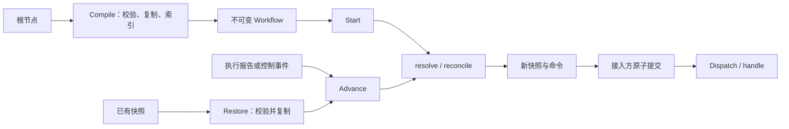

# Schedule 架构

Schedule 是一个可嵌入 Go 系统的静态任务树编排核心。它根据快照和事件计算新快照与命令；持久化、队列、任务执行、重试和超时由接入方负责。

## 代码结构

| 位置 | 职责 |
| --- | --- |
| `proto/schedule/` | 唯一数据契约：任务树、实例、事件、命令和独立状态流 |
| `go/schedule/` | Fino 生成的 Go 类型及枚举支持，不手改 |
| `core/task.go` | `Task/Seq/All/Any` 装配、错误与生命周期常量 |
| `core/compile.go` | 整树校验、不可变定义副本、指纹、节点及父子索引、查询 |
| `core/workflow.go` | `Start/Advance`：初始化、事件校验、更新副本、修订号控制 |
| `core/reduce.go` | `resolve` 汇总组合结果；`reconcile` 激活、阻止分派及收尾 |
| `core/snapshot.go` | `Restore`：校验并复制快照，推导结果就绪和收尾视图 |
| `core/command.go` | 从阶段及控制模式变化生成命令，校验命令基本结构与标识 |
| `core/dispatch.go` | 将命令交给单个处理函数，保留顺序、取消和错误链 |
| `core/stateflow.go` | 独立业务状态流，按 `(from, to)` 查询转换 |
| `core/*_test.go` | 编译、生命周期、组合语义、快照、分派及接入协议测试 |
| `docs/schedule/`、`openapi/` | Fino 生成的契约文档与 JSON Schema |

全部业务实现保持在一个 `core` 包。文件按职责组织，不增加 service、repository、策略注册表或通用 FSM 层。

根 Go 模块通过 `replace` 使用同仓库 `go/` API 模块。两个模块分别承担实现和生成契约的归属；外部接入需要发布匹配版本，或在工作区关联本地 API 模块。

## 调用路径



- `Compile(root)` 直接接收根节点，先验证输入树，再复制和建立索引，避免复制循环结构。定义指纹基于根节点的确定性编码。拒绝空组合、重复 ID、共享节点和循环；深度上限 256，节点上限 10,000。任务的业务元数据由执行器解释。
- `Start(instanceID)` 初始化快照和首批命令。同 ID、同定义计算结果相同，创建是否重复由接入方原子判断。
- `Restore(instance)` 校验身份、节点顺序、阶段、依赖和组合决策；在唯一副本上复用归约规则检查一致性，成功后返回该副本，不重新产生命令。
- `Advance(instance, event)` 复用 `Restore` 返回的副本。先更新叶子并向祖先传播结果，再遍历活跃子树；最后递增修订号并生成命令。输入始终保持不变。

编译前直接装配和追加 `Node.Children`，完整检查统一在 `Compile` 完成。编译后的 `Workflow` 不持有实例状态，可以并发复用。`Root/Node/Path` 返回副本；每个实例的事件仍须由接入方串行提交。

每个编译节点集中保存定义及父子索引，避免维护多组平行切片。ID 索引在校验时按前序建立，复制后的树沿同一顺序装配节点关系。

## 固定执行规则

| 原语 | 结果与后继 |
| --- | --- |
| `Task` | 唯一向 Worker 产生任务命令的节点 |
| `Seq` | 当前子项成功后启动下一项；当前子项终结但不成功时失败，跳过后继 |
| `All` | 并行激活全部子项；全部成功才成功，首次非成功终态锁定失败来源 |
| `Any` | 并行激活全部子项；首次成功锁定胜者及结果引用，全部无成功才失败 |

叶子生命周期为 `Pending → Ready → Running → Succeeded / Failed / Stopped`。完成报告可以从 `Ready` 直接进入终态；`Skipped` 仅用于尚未分派的节点。每个节点只执行一次逻辑任务，执行侧重试保持相同执行标识；重跑流程使用新实例 ID。

`ResultReady` 表示根结果已确定；`Settled` 表示全部节点已终结。`Any` 提前成功后，其余已激活分支继续推进，包括分支内部的串行后继。迟到报告不改写已锁定的胜者或失败来源。

| 控制 | 行为 |
| --- | --- |
| 暂停 | 阻止新分派，继续接收在途结果；待激活后继保留为 `Pending` |
| 恢复 | 继续计算允许执行的后继，包括结果已确定后的收尾分支 |
| 停止 | 阻止新分派，跳过未分派节点，未确定结果的组合标记 `Stopped`；等待在途任务实际收尾 |
| 祖先失败 | 阻止该范围内新增分派，优先于 `Any` 分支继续执行的规则 |

停止不代表物理取消，不撤回已产生的命令。已经确定的组合结果保持不变；全部收尾后拒绝新的控制操作。

执行事件必须绑定实例、已分派的叶子节点和逻辑执行标识；`Event.ExecutionId` 原样回传任务命令的 `Id`。控制事件只携带实例和事件 ID。重复开始、迟到开始或相同终态报告不产生新命令；冲突终态或结果改写返回 `ErrConflict`。结果与组合决策随阶段转换一次写入，同一阶段不会更新这些字段；根控制模式变化可以单独产生状态通知。

事件处理直接确认重复报告与重复控制，只有实际变化才进入归约、递增修订号并生成命令，无需再比较完整快照判断是否发生变化。已收尾实例只接受匹配的重复报告和迟到的开始确认。

## 快照与命令的一致性

快照节点严格按定义前序排列。恢复直接根据节点阶段检查父子激活关系和串行依赖，不另建激活状态数组。随后清空副本中的组合结果，使用同一个 `resolve` 重算并比较；`Any.WinnerId` 和 `All.CauseId` 作为历史选择保留，并验证它们指向合法直接子项。最后运行 `reconcile`，拒绝遗漏汇总、激活或跳过的快照。

这种校验保证状态自洽；仅凭当前快照无法证明哪个事件先被提交。历史顺序由接入方的事务、修订号和事件记录保证。

任务结果引用、组合胜者和失败来源属于实例事实；索引、`ResultReady`、`Settled` 属于派生数据，不再持久化第二份计数或状态。错误摘要区分未设置与显式空字符串，不尝试恢复 Go 错误链。

每个实例内节点只执行一次逻辑任务，执行标识由实例 ID 和节点 ID 派生，在任务命令生成、分派校验和执行报告校验时按需计算。快照通过节点阶段记录分派事实，不保存重复的执行标识；可预测的标识不能替代分派资格检查。

命令固定按状态通知、任务分派、结束通知排列，同类按定义顺序排列。每条命令携带稳定 ID、实例与定义绑定、修订号、当前节点状态和控制模式，任务命令另含完整叶子定义。通知表达当前状态；前后状态比较由消费方的投影视图处理，层级路径通过 `Workflow.Path` 按需查询。任务分派与逻辑执行共用 ID；`END` 只在首次全部收尾时生成。快照、命令和回调参数之间不共享可变数据。

`Dispatch(ctx, handle, commands)` 只接收一个命令处理函数，由接入方按 `command.Kind` 处理任务或通知。在首个错误或取消时停止，返回包含位置、命令 ID 和原始错误的 `DispatchError`。命令校验只检查基本结构与标识，不替代完整快照校验或执行器的业务检查。

| 输入边界 | 校验责任 |
| --- | --- |
| 实例快照 | `Restore` 检查定义绑定、节点事实、依赖和组合结果 |
| 执行或控制事件 | `Advance` 检查事件载荷；执行报告须指向已分派叶子，并匹配由实例与节点派生的执行标识 |
| 已保存的 outbox 命令 | `Dispatch` 独立检查基本结构、命令 ID 和任务绑定，不依赖实例或重新加载任务树 |

## 接入方责任

1. 在同一事务中保存事件去重记录、新快照和 outbox 命令，按旧修订号 CAS 更新或持有实例锁。同 ID、不同定义不能覆盖已有实例。
2. 相同事件 ID、相同内容返回已记录的确认；相同 ID、不同内容视为冲突。尤其要防止旧暂停事件在恢复后被再次应用。
3. 按命令 ID 幂等创建任务和消费通知。保存后、入队前崩溃时重发原命令；`Restore` 不补造命令。
4. 接入执行系统已有的队列、超时、重试和取消能力。回调失败不回滚快照，不自动重放整批命令；`Settled` 不代表结束通知已经送达。

公开 API 测试从编译和启动开始，分别序列化快照与 outbox，再重新编译、恢复、重投命令并接收结果，覆盖当前状态通知和收尾。事件去重及并发提交协议另由内存 journal 测试验证；生产数据库事务与消息投递仍由接入系统验证。

## 保持收敛的边界

- 当前模型只支持静态树。跨分支依赖、动态扩图、循环工作流、补偿和全局配额需要新的实际用例，不能靠增加类型和策略参数提前覆盖。
- `Advance` 每次仍需 O(N) 的完整快照复制与命令扫描，校验还会检查依赖和跳过来源。结果汇总先沿祖先传播，调度再遍历活跃子树；已有 1,000 任务基准，尚无增量缓存或大规模吞吐承诺。
- 独立 `Stateflow` 只保存初始状态和转换表。`Initial()` 返回初始状态，`Step(from, to)` 查询合法转换，`HasNext(state)` 判断有无出边；业务保存当前状态及所属定义。它不参与任务生命周期，也不提供实例快照或恢复协议。
- 生成枚举的 JSON 支持依赖 Fino 共享运行时。若要缩减这部分传递依赖，应修改生成选项或生成器，不能删除受管文件绕过归属。
- `skills/` 和 `.fino/issues/` 属于协作工具，不进入运行链路。本项目没有 backend、frontend、数据库或应用发布配置。

## 验证

实现改动运行 `go test ./...`；涉及共享定义或快照隔离时补充 `go test -race ./...`。静态检查用 `go vet ./...`，API 模块单独执行 `cd go && go test ./...`。

`FuzzWorkflow` 用最多 4 层、40 个节点的组合树检查恢复一致性、输入隔离、重复事件幂等、决策锁定和命令唯一性。普通测试运行种子样本，持续 fuzz 和 1,000 任务基准按需执行：

```bash
go test ./core -run '^$' -fuzz '^FuzzWorkflow$' -fuzztime=60s -parallel=2
go test ./core -run '^$' -bench 'Benchmark(Compile|Advance)$' -benchmem -cpu=1 -count=5
```

契约变化先改 `proto/`，再运行 `fino doctor --output=. --targets=api` 和 `fino build --output=. --targets=api`，检查受影响的生成产物；仅修改核心实现时无需重新生成。
